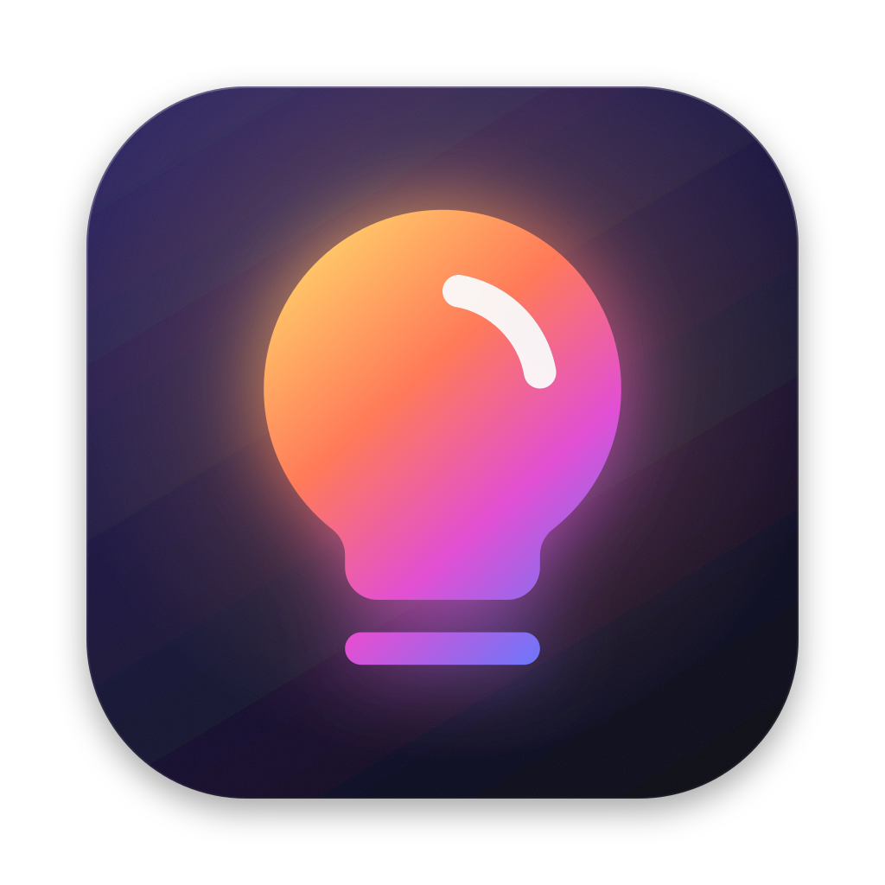

<p align="center">
  
</p>

<h1 align="center">HueBar</h1>

<p align="center">
  Control your Philips Hue lights from the macOS menu bar.
</p>

<p align="center">
  <a href="https://github.com/dirien/huebar/actions/workflows/ci.yml"></a>
  <a href="https://github.com/dirien/huebar/releases"></a>
  
  
</p>

HueBar talks to your Hue Bridge directly on your local network using the [Hue CLIP v2 API](https://developers.meethue.com/develop/hue-api-v2/). There's no cloud account involved.

- The header shows how many lights are on, with a master power button
- Room and zone cards are tinted with the colors of their lit lights, with a Control Center–style brightness bar
- Expanding a room shows its scenes and lights; white lights get a warm-to-cool temperature track
- Color lights get a hue/saturation color wheel, quick presets, and an eyedropper that picks any color on your screen
- Live state from the bridge's event stream, so changes from the Hue app or a wall switch show up immediately
- Sliders read 0 while a light is off; dragging to 0 turns it off, dragging up turns it on
- Finds the bridge via Bonjour and follows it if DHCP gives it a new IP address
- Optional launch at login

The menu bar icon shows the connection state: a filled bulb when connected and a light is on, an outlined bulb when connected and everything is off, and unplugged plugs when HueBar isn't connected.

## Install

With [Homebrew](https://brew.sh):

```bash
brew install --cask dirien/dirien/huebar
```

Or by hand:

1. Download `HueBar-<version>.dmg` from the [latest release](https://github.com/dirien/huebar/releases/latest).
2. Open it and drag **HueBar** to **Applications**.

Then:

3. Open HueBar. Releases are currently signed ad hoc rather than notarized by Apple, so macOS blocks the first launch. Open **System Settings → Privacy & Security**, scroll down, and click **Open Anyway** next to HueBar. You only need to do this once per version.
   (Since macOS 15, Control-click → Open no longer bypasses this. Alternatively run `xattr -dr com.apple.quarantine /Applications/HueBar.app`.)
4. Click the bulb in the menu bar and allow HueBar to find devices on your local network.
5. Pick your bridge (or enter its IP address), click **Pair**, and press the round link button on top of the bridge. HueBar waits 90 seconds and shows the ID of the bridge it's waiting on (the last six characters of its Bonjour name) so you can be sure you're pressing the right one.

Requires macOS 14 (Sonoma) or later and a square (v2) Hue Bridge. The app is a universal binary for Apple silicon and Intel.

## Build from source

You need Xcode 16 or later (or its Command Line Tools) and, for linting, [SwiftLint](https://github.com/realm/SwiftLint): `brew install swiftlint`.

```bash
make install    # build, copy to /Applications and launch
```

Run `make` on its own to list all tasks:

| Task | What it does |
| --- | --- |
| `make build` | Debug build |
| `make test` | Unit tests (Swift Testing) |
| `make lint` | swift-format and SwiftLint in strict mode; changes nothing |
| `make format` | Reformat with swift-format |
| `make fix` | Format, apply SwiftLint auto-fixes, then report what's left |
| `make check` | `lint` + `build` + `test`, i.e. what CI runs |
| `make app` | Build `build/HueBar.app` |
| `make install` | Build, install to `/Applications`, launch |
| `make dmg` | Universal release build packaged as a DMG and ZIP in `build/` |
| `make icons` | Regenerate the Phosphor icon file |
| `make app-icon` | Regenerate `Resources/AppIcon.icns` from `assets/logo.svg` (needs `brew install librsvg`) |
| `make social-preview` | Regenerate the GitHub social preview, `assets/social-preview.png` (needs librsvg and the Inter font) |

Formatting is owned by swift-format (`.swift-format`, 4-space indent, 120 columns). SwiftLint (`.swiftlint.yml`) covers correctness and idiom, with its formatting-only rules turned off so the two don't disagree.

Builds signed ad hoc count as a new app to the Keychain every time you rebuild, so macOS asks once whether HueBar may read its app key; click **Always Allow**. To avoid that, sign with a stable identity: `SIGN_IDENTITY="Apple Development: you@example.com" make install` (list yours with `security find-identity -p codesigning -v`).

## Releasing

Pushing a tag like `v1.2.0` runs [`release.yml`](.github/workflows/release.yml) on a macOS runner. It tests, builds a universal app, packages `HueBar-1.2.0.dmg`, `HueBar-1.2.0.zip` and `SHA256SUMS.txt`, and publishes a GitHub release. Tags with a suffix such as `v1.2.0-beta.1` become pre-releases. Running the workflow by hand builds the same files as run artifacts without publishing.

```bash
git tag v1.2.0 && git push origin v1.2.0
```

For final (non-pre-release) versions, the [`homebrew.yml`](.github/workflows/homebrew.yml) job then points `Casks/huebar.rb` in [dirien/homebrew-dirien](https://github.com/dirien/homebrew-dirien) at the new DMG, runs `brew style` and `brew audit --strict --online` on it, and pushes it to the tap. Pushing needs a `HOMEBREW_TAP_DEPLOY_KEY` secret: the private half of an SSH deploy key with write access to the tap. Without it the cask is still audited, and you can update the tap by hand.

### Signing and notarization

Without extra setup, releases are signed ad hoc, which is why users have to click **Open Anyway** once. To ship builds that open without any warning, join the [Apple Developer Program](https://developer.apple.com/programs/), create a **Developer ID Application** certificate, and add these repository secrets. The workflow then signs with the hardened runtime, notarizes the DMG with `notarytool`, and staples the tickets.

| Secret | Value |
| --- | --- |
| `MACOS_CERTIFICATE` | The Developer ID Application certificate exported as `.p12`, base64-encoded (`base64 -i cert.p12 \| pbcopy`) |
| `MACOS_CERTIFICATE_PASSWORD` | The password of that `.p12` |
| `NOTARY_APPLE_ID` | The Apple ID of your developer account |
| `NOTARY_TEAM_ID` | Your team ID |
| `NOTARY_PASSWORD` | An [app-specific password](https://support.apple.com/102654) for that Apple ID |

Notarization matters for Homebrew too. Homebrew applies quarantine to cask downloads so Gatekeeper still checks them, has removed `--no-quarantine`, and since September 2026 no longer accepts casks that fail Gatekeeper checks in the official `homebrew/cask` repository. That's why HueBar ships from its own tap for now, with a caveat explaining the one-time **Open Anyway** step instead of silently stripping quarantine. Once releases are notarized, the caveat can go and the cask could be submitted to `homebrew/cask`.

## How it works

- **Certificate pinning.** The bridge uses a certificate from Signify's private CA, which macOS doesn't trust. HueBar records the certificate's SHA-256 fingerprint when you pair and refuses a different one later. If you reset or replace the bridge, use *Settings → Forget this bridge* and pair again.
- **Storage.** The app key the bridge issues lives in your login Keychain; the bridge's address and certificate fingerprint are in the app's user defaults.
- **Rate limits.** The bridge handles about 10 light commands and 1 group command per second, so HueBar coalesces slider movements and sends only the latest value.
- **Icons.** `Sources/HueBar/Icons/PhosphorIcons.swift` is generated by `Scripts/generate-phosphor-icons.py` from [`@phosphor-icons/core`](https://www.npmjs.com/package/@phosphor-icons/core). The script rewrites each SVG path (including arcs) as move/line/curve commands that SwiftUI can draw, so there are no font or asset files to bundle. To add an icon, add it to `ICONS` in the script and run `make icons`.

```
Sources/HueBar/
  HueBarApp.swift              MenuBarExtra entry point and menu bar icon
  Hue/HueClient.swift          HTTPS client, certificate pinning, pairing, event stream
  Hue/Models.swift             CLIP v2 resources and event payloads
  Hue/Commands.swift           Request bodies (light/grouped_light/scene)
  Hue/ColorMath.swift          sRGB ↔ CIE xy, gamut clamping, color temperature
  Hue/EventStreamParser.swift  Server-Sent Events framing
  Hue/BridgeDiscovery.swift    Bonjour (_hue._tcp) discovery
  Icons/                       Phosphor icon rendering and generated icon data
  Store/HueStore.swift         App state, optimistic updates, write coalescing, reconnects
  Store/Persistence.swift      Paired-bridge settings and Keychain
  Views/                       SwiftUI menu content and controls
Tests/HueBarTests/             Decoding, event stream, commands, color math, icon paths
```

## Credits

Icons by [Phosphor Icons](https://phosphoricons.com) (MIT License). Philips Hue is a trademark of Signify; HueBar is not affiliated with Signify.
